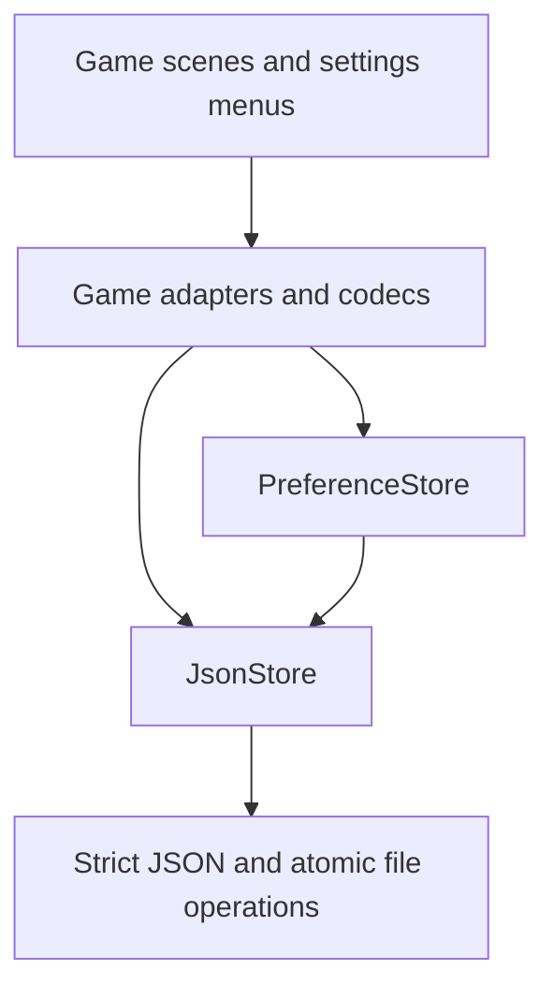

# Shared saves and preferences technical design

Introduce a standard-library-only `engine.persistence` package for reliable JSON storage and validated preferences. Games supply document codecs, schemas, paths, and application behavior. Existing save locations, JSON shapes, and game version numbers remain unchanged during adoption.

The current implementation scope is engine-only: storage, backup recovery, explicit replacement, and preference validation. Game adapters and the adoption steps below remain follow-up work. Background scheduling stays with the current callers. See the [engine API documentation](../engine-persistence.md) for usage; importing the package does not migrate any existing game or save file.

## Existing implementations

| Consumer | Current document and limits | Behavior to retain |
| --- | --- | --- |
| [Particle career](../../src/sandbox_3d/persistence/career_save.py) | Format `python3d.sandbox-career`, version 2, 8 MiB | Previous-good backup; damaged primary blocks ordinary saves; unsupported primary stops recovery. |
| [Bulk career](../../src/sandbox_3d/persistence/bulk_save.py) | Format `python3d.sandbox-bulk`, version 1, 16 MiB | Backup recovery; separate particle-to-bulk import; original particle file preserved. |
| [Terrain world](../../src/sandbox_3d/persistence/terrain_save.py) | Format `python3d.terrain-world`, version 1, 32 MiB | Independent slots; compressed terrain validation and larger allowances for encoded layers. |
| [Galaxy exploration](../../src/empty_game/exploration.py) | Root `version`, `active_seed`, `galaxies`; reads versions 1–12, writes 12; 16 MiB | Existing domain migrations, dirty state, retry behavior, and save triggers. |
| [Sandbox preferences](../../src/sandbox_3d/persistence/preferences.py) | Bare settings object, 64 KiB | Reject invalid ranges and choices; default individual invalid fields on load; publish edits after saving. |
| [First-person settings](../../src/game/settings.py) | Reads a bare object or settings envelope; writes version-1 envelope | Existing path override, defaults, recognized keys, and finite numeric clamping. |

Bulk and terrain currently attempt read-only backup recovery for unsupported primary versions. Particle stops immediately. Keep that distinction explicit in adapter policies. Galaxy currently has no backup recovery; adopting it is a deliberate addition.

## Ownership and package layout

| Engine owns | Game owns |
| --- | --- |
| Bounded JSON reads, strict parsing, serialization, temporary files, atomic replacement | Document envelopes, format identifiers, accepted versions, timestamps, payload validation |
| Backup and archive mechanics, structured results, locking | Paths, slot names and metadata, cross-format imports, migration decisions |
| Preference validation, candidate updates, adjustment, commit ordering | Setting keys, defaults, labels, descriptions, formatting, live effects |
| File-level failures and diagnostic codes | Player-facing messages, save cadence, dirty state, pause/discard/exit policy |

Proposed modules:

```text
engine/persistence/
    __init__.py       Public types and entry points
    json_io.py        Limits, strict JSON reading and encoding
    atomic.py         Temporary files, replacement, archives and shared locks
    store.py          Codec protocol, results, recovery and write sequencing
    preferences.py    Field specs, schema and committed preference values
```

The package imports no Pygame, OpenGL, NumPy, game packages, or engine runtime configuration. Importing it creates no directories or threads and reads no user files.



## Public storage contract

Use a codec protocol so the engine never imposes a universal envelope or migration chain:

```python
class JsonCodec(Protocol[T]):
    def decode(self, document: JsonValue) -> Decoded[T]: ...
    def encode(self, value: T) -> JsonValue: ...

store = JsonStore(
    path,
    codec=CareerCodec(),
    limits=JsonLimits(max_bytes=8 * 1024 * 1024),
    policy=StorePolicy(
        backup=True,
        unsupported_primary="stop",
    ),
)

loaded = store.load()
written = store.write(snapshot)
# Used only by a deliberate new-world or reset action:
replacement = store.replace_with_archive(new_snapshot)
```

These signatures describe the proposed API, not executable implementation. `JsonValue` means plain JSON data. `T` is the game's validated snapshot or decoded data record. Codecs must validate outgoing values and incoming documents, return detached data, and avoid mutating a live scene. Existing domain validators can remain inside the adapters.

`Decoded[T]` contains `value`, `needs_save`, and optional diagnostics. `needs_save` indicates an accepted older representation was normalized in memory; it does not trigger a write.

`LoadResult[T]` contains:

- `value`: decoded data, or `None` when no usable document exists.
- `source`: `primary`, `backup`, or `none`.
- `primary_state` and `backup_state`: observations of the files inspected. An uninspected backup has no state.
- `writable`: whether ordinary saving is allowed for the observed state.
- `needs_save`: the codec's migration indicator.
- `issues`: diagnostic codes, affected paths, and developer details.

File states are `missing`, `valid`, `invalid`, `wrong_format`, `unsupported`, and `io_error`. A recognized format with an unaccepted version is unsupported; another format is wrong-format. This distinction preserves particle recovery behavior. Only `FileNotFoundError` means missing.

`WriteResult` contains `committed`, an optional failure issue, cleanup warnings, and any archive paths. `committed=True` means the primary replacement succeeded. Cleanup trouble after that point is a warning, not a failed save. Adapters preserve their existing public return shapes, including Sandbox's `SaveResult.saved` and the other games' booleans.

Codecs translate expected schema errors into `InvalidDocument`, `WrongFormatDocument`, or `UnsupportedDocument`. The store translates those and filesystem/JSON failures into results. Unexpected programming errors propagate; the engine does not silently classify every exception as a damaged save.

### JSON rules

Read at most `max_bytes + 1` bytes from an open file before decoding. Reject excess bytes, malformed UTF-8, duplicate object keys, nonfinite constants, and numbers that overflow to infinity such as `1e999`. Recursion failures become invalid-document results. Before encoding, validate an acyclic tree of exact built-in JSON types: dictionaries with string keys, lists, strings, finite numbers, booleans, and null. Reject non-string keys, tuples, custom containers, and numeric/container subclasses rather than relying on `json.dumps` coercion. Adapters explicitly convert domain types to this tree. Check the final UTF-8 byte length before filesystem mutation.

Optional depth and node budgets are configured per codec. Field-specific limits, including terrain layer text and domain numeric bounds, remain game validation rules. Do not apply the particle career's limits to every format. Version checks require actual integers, so `true` is never accepted as version `1`.

Adapters select compact or indented output to retain existing formatting conventions. Formatting may change without changing the document schema; backups and archives preserve original bytes exactly.

## Recovery behavior

Loading never creates, repairs, renames, or deletes files. A backup is usable only after the same codec and full validation used for the primary succeed.

| Primary | Backup | Returned data | Ordinary writes |
| --- | --- | --- | --- |
| Valid | Not inspected | Primary | Allowed |
| Missing | Missing | None | Allowed |
| Missing | Valid | Backup | Allowed; retain backup while creating a new primary |
| Missing | Invalid, wrong format, or unsupported | None | Blocked |
| Missing | I/O error | None | Blocked |
| Invalid or wrong format | Valid | Backup | Blocked; recovery is read-only |
| Invalid or wrong format | No usable backup | None | Blocked |
| Unsupported | Any | None with `stop`; valid backup with `readonly_backup` | Blocked |
| I/O error | Valid | Backup for read-only use | Blocked |
| I/O error | No usable backup | None | Blocked |

Stores with backups disabled use only the primary observations. Permission errors, sharing violations, and directories at a file path must not become an empty writable store.

Particle and Galaxy use `unsupported_primary="stop"`. Bulk and terrain use `readonly_backup` to retain their current recovery behavior. Particle still attempts read-only recovery for a wrong-format primary. A normal write re-inspects the current primary and any backup needed to establish eligibility under the lock; an old `writable=True` result cannot authorize overwriting later damage.

Missing-primary plus unusable-backup protection is an intentional improvement. Today that combination can be treated as a fresh writable slot. Bulk import must run only when both destination files are genuinely absent, and must validate its converted result before returning it. Import never modifies the particle source.

## Write and replacement sequencing

For an ordinary write:

1. Validate and encode the detached snapshot, enforce JSON and byte limits, and retain the resulting bytes.
2. Acquire the lock shared by stores for this primary path. Inspect current disk state and refuse protected or inaccessible documents.
3. Create the parent directory if needed. Write the new bytes to a uniquely named temporary sibling, flush, and `fsync` the file.
4. If backups are enabled and the primary is valid, write its exact bytes to another flushed temporary sibling and atomically replace the `.bak` file. An existing `.bak` is the rotating previous generation. Never rotate invalid primary bytes into it.
5. Atomically replace the primary with the prepared new file. This is the commit point.
6. Release the lock and clean remaining temporary files. Report cleanup errors separately from commit status.

Backup failure aborts before changing the primary. If the primary is missing and the backup is valid, leave that backup intact. A failure before the primary commit preserves the old primary, although the backup may already have been refreshed.

`replace_with_archive` is a distinct operation for an explicitly selected new world or reset. It validates the replacement first, then preserves exact existing primary and configured backup bytes under unique archive names before changing either managed file. Archive the entire file by streaming, independently of the JSON decode byte limit; an oversized invalid file must still be preserved completely. Flush archives before continuing. Failure to read or preserve an existing file aborts replacement. Return archive paths even when a later step fails.

When backups are enabled, remove the old managed `.bak` only after its complete archive is flushed, then commit the prepared new primary. Successful replacement starts the new world without a rotating backup; its next ordinary save establishes one from that world's validated primary. This prevents recovery from crossing back into the deliberately replaced world. A failure before primary commit may leave the old backup available only through its returned archive path, while the original primary remains unchanged. Do not install replacement data as a backup before the primary commit: a failed replacement must not expose an uncommitted new world through backup recovery. Stores with backups disabled manage only the primary.

The replacement method also accepts an optional `required_primary_state`. Check this condition inside the same path lock used for archiving and commit. A mismatch returns `state_changed` without modifying files. Preference repair uses `required_primary_state="invalid"`; a deliberate new-world/reset action has no state restriction, but still cannot bypass I/O or preservation failures. Existing `allow_replace_invalid` arguments become adapter shims for explicit replacement; they do not weaken ordinary writes.

Atomic replacement gives complete-old-or-complete-new visibility for each individual file. Primary, backup, archives, and slot metadata are separate commits. File `fsync` plus replacement does not promise survival of every power failure on every filesystem; portable directory durability is outside the initial guarantee. Unique temporary files left by a terminated process are ignored by loading and slot enumeration. Broad cleanup of other processes' temporary files is outside this change.

### Concurrency and snapshots

Use a shared in-process lock registry keyed by expanded, resolved, platform-normalized primary paths. All stores targeting the same path share a lock covering inspection, preservation, and commit. Unrelated settings files do not wait for a large terrain save.

One logical owner supplies snapshots for each path. Locks serialize file operations; they do not merge stale snapshots. Concurrent processes writing the same save are unsupported in this phase. Cross-process locking and conflict detection require a separate requirement.

The existing Sandbox worker remains game-owned. Capture snapshots on the main thread and submit detached data; workers must not observe live dictionaries or NumPy views. Keep its coalescing, manual-save priority, shutdown waits, and discard behavior unchanged. The new store is synchronous and can be called from that worker. No new executor or autosave scheduler is introduced.

## Preferences

Provide `PreferenceSpec`, `PreferenceSchema`, and `PreferenceStore` above the storage layer:

```python
schema = PreferenceSchema({
    "fov": PreferenceSpec(
        default=60.0, value_type=float,
        minimum=45.0, maximum=90.0,
        range_policy="reject", step=5.0, round_digits=6,
    ),
})

preferences = PreferenceStore(store, schema=schema)
loaded = preferences.load()
changed = preferences.update({"fov": 75.0})
```

Specs describe types, defaults, bounds, optional choices, range policy, rounding, and adjustment steps. Labels, descriptions, value formatting, and applying values to the world stay in the game. `step` controls adjustment; it does not restrict saved values to multiples of that step. Numeric fields accept integers or floats as their schema permits, but reject booleans and nonfinite values. Integer choices require actual integers.

Sandbox keeps range rejection, six-decimal rounding, exact integer choices, and bare-object encoding. The first-person game keeps finite numeric clamping, its envelope, and support for legacy bare objects. Missing fields default; unknown fields remain ignored according to current adapters. Invalid individual fields in a successfully parsed document use defaults with diagnostics. Strict JSON rejection, including nonfinite numbers, invalidates the whole document and yields all defaults. Neither case writes a repaired document during load.

Preference mutations follow this order:

1. Validate all proposed fields into a candidate copy.
2. Persist the complete candidate.
3. After successful commit, publish a read-only snapshot of committed values.
4. The game applies committed values to its scene and updates menu feedback.

`set`, `update`, `adjust`, `reset`, and full-save paths use this ordering. Validation or storage failure leaves committed values and live effects unchanged. The engine does not run scene callbacks. If applying a committed value raises a programming error, the saved candidate remains authoritative and the error surfaces; filesystem and renderer updates are not one transaction.

Malformed preferences may be repaired on an explicit settings edit/reset using a preference-only `repair_invalid_on_edit` policy. Use guarded replacement with `required_primary_state="invalid"`, evaluated under the preservation/commit lock. A separate load/check followed by unrestricted replacement is prohibited: an intervening wrong-format or unsupported file must block the edit. This policy never bypasses I/O failure. An explicit reset can use unrestricted `replace_with_archive`. This preserves user-driven settings recovery while adding an archive of the displaced data.

An unsupported version in the first-person game's settings envelope yields defaults with ordinary writes disabled. Envelopes with omitted version metadata remain accepted for compatibility. Sandbox's unversioned preferences cannot reliably identify a future schema; retain that limitation during extraction.

The [Sandbox frontend](../../src/sandbox_3d/scenes/frontend.py) already applies values after successful preference updates. The [first-person settings callbacks](../../src/game/ui/setting_menu.py) currently mutate scene state before saving. Migrate those callbacks to candidate-first updates and a game-owned application function. Replacing the file writer alone would not provide rollback of live settings. Retain the existing `Preferences`, `load_settings`, `save_settings`, and `validate_settings` facades while callers migrate.

## Adoption and compatibility

| Adapter | Adoption requirements |
| --- | --- |
| Sandbox career formats | Keep current functions, paths, envelope fields, versions, warnings, and slot routing. Move reusable file helpers out of the particle module. Keep per-format validators and terrain compression in the game. |
| Bulk import | Preserve conversion logic and paid-volume history. Import only into an absent destination; preserve the source and validate the result. |
| Save slots | Use public JSON/atomic helpers for metadata and the last-slot pointer. Keep IDs, directory checks, naming, listing, and deletion game-owned. Metadata and snapshots remain separate commits. |
| Sandbox preferences | Keep the public facade and exception behavior. Translate structured failures to existing `ValueError`/`OSError` behavior where required. |
| First-person settings | Preserve `PY3D_SETTINGS_PATH`, current per-user directories, file shape, defaults, and finite clamping. Add a 64 KiB bound. Migrate live setting callbacks explicitly. |
| Galaxy exploration | Keep the existing version-dependent decoder and encoder. Accept versions 1–12 and write 12. Enable previous-good backups, stop on unsupported primary versions, and allow damaged-primary backup recovery only as a read-only session. |

Galaxy retains clean/no-path save success without I/O, migration-driven dirty state, seed overrides, milestone and timed saves, existing launch/shutdown triggers, and retry-after-failure behavior. Only successful commit clears dirty/error state. The adapter maps engine recovery eligibility to its existing write-enable flag. Codec migration never causes the store itself to save; caller lifecycle remains responsible.

Intentional changes are limited to bounded strict reads, exact version typing, finite numeric validation, protected orphan backups, Galaxy backup recovery, settings archives on repair, unsupported settings-version protection, and publish-after-save settings updates. Paths and version numbers do not change. No user's save is rewritten merely to adopt the package.

## Implementation sequence and acceptance checks

1. Characterize existing adapter behavior with temporary, representative fixtures for all Sandbox formats, preference forms, and Galaxy versions 1–12. Record the intentional changes above separately from compatibility expectations.
2. Implement strict JSON and atomic-file operations, then the store's recovery results and backup/replacement policies. Verify failure boundaries before migrating callers.
3. Migrate particle, terrain, and bulk adapters in that order, followed by slot metadata helpers. Keep public facades so simulation and frontend changes remain small.
4. Migrate Sandbox preferences, then first-person settings and their live application callbacks.
5. Migrate Galaxy transport while retaining its domain decoder and lifecycle. Enable backup behavior with explicit recovery cases.
6. Run focused regression checks and manual save/load/settings smoke checks across all games, then update engine API documentation. A shared background-save controller is deferred.

Acceptance requires:

- Known save fixtures retain terrain/material quantities, cargo, vehicle poses, career state, and Galaxy histories after load/save/load. Older supported Galaxy documents upgrade through their existing decoder.
- Every primary/backup combination in the recovery table behaves as specified. Loading leaves file bytes and directory contents unchanged.
- Injection of validation, write, flush, `fsync`, archive, backup replacement, or primary replacement failure preserves the old primary before commit. Failure after commit reports success with a warning. Invalid data never replaces a valid backup.
- Duplicate keys, malformed UTF-8, truncated documents, excessive byte counts, deep structures, nonfinite/overflow numbers, and boolean versions are rejected predictably. Outgoing non-string keys, tuples, cycles, and custom types fail before filesystem mutation.
- A normal write independently refuses a primary changed to invalid, wrong-format, or unsupported data after load. Particle wrong-format recovery still differs from unsupported-version handling. Explicit replacement preserves displaced files, including oversized invalid files, byte-for-byte. A successful reset leaves no rotating backup until the next ordinary save; failure after old-backup removal returns its archive and never makes the new snapshot recoverable before primary commit.
- Deterministic thread tests using barriers verify shared-path serialization and valid primary/backup generations. Unrelated paths use independent locks.
- Preference load, update, adjustment, reset, and failure cases preserve each game's range policy and file shape. Failed commits retain previous committed values and live effects. A barrier test changes an invalid file to an unsupported document before repair takes its lock and verifies that guarded replacement refuses it.
- Existing path overrides remain isolated. Galaxy clean/no-path saves and read-only recovered sessions do not write; failures remain dirty for retry.
- Engine persistence imports succeed without graphics/game dependencies, all temporary files live beside their destination, and ordinary successful operations leave none behind.

Use temporary directories and focused checks during implementation. Follow the repository's [testing policy](../../README.md#testing-policy), which currently calls for removing temporary tests when feature work is complete. Validation must use fixture files rather than existing player saves.
